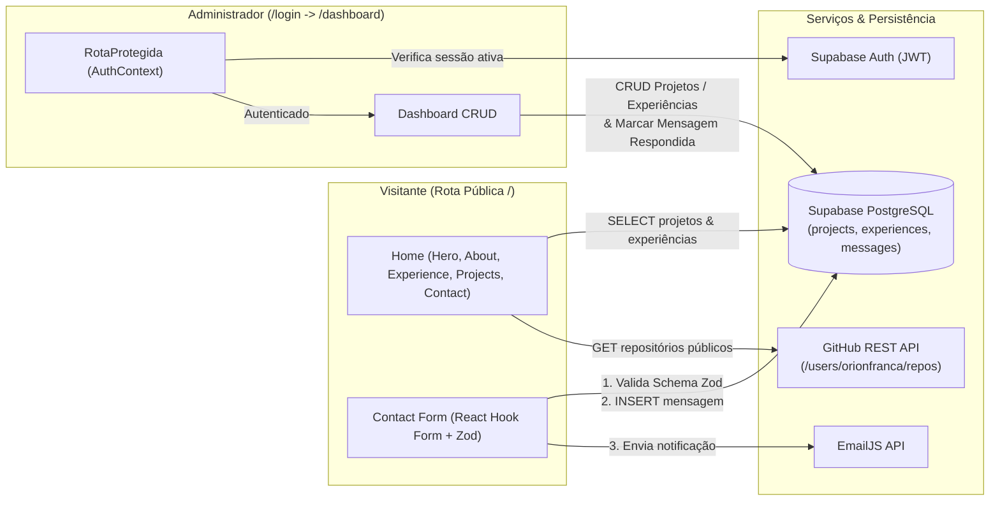
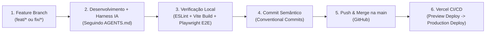

# Portfólio Full-Stack — Orion França

Portfólio interativo em estilo Pixel Art / Neo-Brutalista com painel administrativo (Dashboard), autenticação, gerenciamento dinâmico de projetos/experiências/mensagens no **Supabase**, integração com a **API do GitHub** e envio de e-mails via **EmailJS**.

---

## 1. Stack Tecnológica

| Camada                               | Tecnologia                       | Papel no Projeto                                                                                  |
| :----------------------------------- | :------------------------------- | :------------------------------------------------------------------------------------------------ |
| **Front-end Core**             | React 19 + Vite 8                | Renderização declarativa de UI, HMR rápido e bundle otimizado                                  |
| **Estilização**              | Tailwind CSS v4 + CSS Custom     | Utilitários responsivos, Dark Mode (`ThemeContext`) e estética Neo-Brutalista / Pixel Art     |
| **Roteamento**                 | React Router DOM v7              | Rotas públicas (`/`, `*` 404), autenticação (`/login`) e rota protegida (`/dashboard`) |
| **Formulários & Validação** | React Hook Form + Zod            | Controle performático de formulários sem re-renders desnecessários e validação por schema    |
| **Back-end / BaaS**            | Supabase (PostgreSQL + Auth)     | Banco de dados relacional para projetos, experiências e mensagens + Autenticação JWT           |
| **Integrações Externas**     | GitHub REST API + EmailJS        | Listagem dinâmica de repositórios públicos e disparo de notificações por e-mail              |
| **Testes E2E**                 | Playwright + Python (`pytest`) | Testes ponta a ponta cobrindo bloqueio de rota privada, validação Zod e página 404             |
| **Deploy & Hosting**           | Vercel                           | CI/CD automático integrado ao GitHub com SPA Rewrite (`vercel.json`)                           |

---

## 2. Arquitetura e Estrutura de Pastas

### Critério de Divisão de Componentes

A arquitetura segue a separação por **responsabilidade e escopo de reutilização**:

- **`src/pages/`**: Componentes de nível de rota (`Home`, `Login`, `Dashboard`, `NotFound`). Coordenam o layout da página e o consumo de contextos.
- **`src/components/layout/`**: Seções estruturais de domínio da página inicial (`Navbar`, `Hero`, `About`, `Experience`, `Projects`, `Contact`, `Footer`).
- **`src/components/ui/`**: Elementos visuais atômicos ou interativos reutilizáveis (botões, cursores, elementos decorativos).
- **`src/contexts/`**: Estado global compartilhado (`AuthContext` para sessão do Supabase e `ThemeContext` para alternância Dia/Noite com persistência em `localStorage`).
- **`src/lib/`**: Instâncias e clientes de serviços externos isolados da UI (`supabase.js`).

```
meu-portfolio-react/
├── .agent/                        # Harness de IA versionado no repositório
│   ├── rules/
│   │   └── coding-and-git-standards.md
│   ├── skills/
│   │   └── portfolio-quality-gate/
│   │       └── SKILL.md
│   └── mcp.json                   # Conectores MCP configurados para o agente
├── AGENTS.md                      # Instruções globais de arquitetura e padrões para a IA
├── public/                        # Arquivos estáticos públicos (currículo PDF)
├── src/
│   ├── assets/                    # Sprites pixel art (dia/noite), ícones e imagens
│   ├── components/
│   │   ├── layout/                # Seções da aplicação (Hero, About, Experience, Projects, Contact, Navbar, Footer)
│   │   └── ui/                    # Componentes visuais reutilizáveis
│   ├── contexts/                  # AuthContext (Supabase Auth) e ThemeContext (Dark/Light Mode)
│   ├── lib/                       # Cliente Supabase (supabase.js)
│   ├── pages/                     # Rotas: Home.jsx, Login.jsx, Dashboard.jsx, NotFound.jsx
│   ├── App.jsx                    # Configuração de rotas e guardião <RotaProtegida>
│   └── main.jsx                   # Ponto de entrada da árvore React
├── tests/
│   └── test_portfolio.py          # Testes E2E automatizados com Playwright + Python
└── vercel.json                    # Regra de rewrite para suporte a SPA na Vercel
```

---

## 3. Diagrama de Fluxo de Dados



---

## 4. Fluxo de Alteração: Da Branch ao Deploy (CI/CD)




---

## 5. Como Baixar e Rodar em Outros Dispositivos

### Pré-requisitos
- **Node.js** (versão 18 ou superior)
- **Git** instalado
- *(Opcional, para rodar os testes E2E)* **Python 3.10+**

### Passo a Passo

1. **Clonar o repositório:**
   ```bash
   git clone https://github.com/SEU-USUARIO/meu-portfolio-react.git
   cd meu-portfolio-react
   ```

2. **Instalar as dependências do projeto:**
   ```bash
   npm install
   ```

3. **Configurar as variáveis de ambiente (`.env`):**
   Crie um arquivo chamado `.env` na raiz do projeto com as chaves do seu projeto no Supabase:
   ```env
   VITE_SUPABASE_URL=sua_url_do_supabase
   VITE_SUPABASE_ANON_KEY=sua_chave_anon_do_supabase
   ```

4. **Iniciar o servidor de desenvolvimento:**
   ```bash
   npm run dev
   ```
   O site ficará disponível em `http://localhost:5173`.

5. **Executar os testes automatizados (Opcional):**
   Em outro terminal (com o `npm run dev` rodando):
   ```bash
   pip install playwright pytest-playwright
   python -m playwright install chromium
   python tests/test_portfolio.py
   ```
